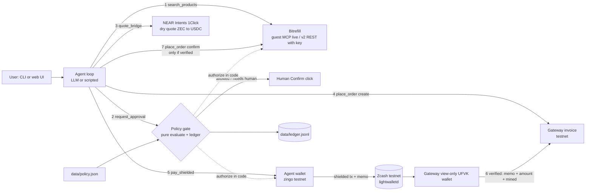

# ZecRecharge

**An AI agent that pays Indian mobile recharges and gift cards from a shielded-ZEC wallet: the payment goes to a viewing-key gateway, only a verified payment unlocks the Bitrefill order, and a spending mandate the agent cannot override bounds every purchase. Zcash testnet and free Bitrefill test products; Bitrefill never receives ZEC.**

- Repo: https://github.com/AaroneGeorge/Zzzz
- Demo video: https://github.com/AaroneGeorge/Zzzz/releases/download/v1.0-demo/zecrecharge-demo.mp4
- Entered in **both** tracks: Privacy and Agentic (see [Track split](#track-split)). Licence MIT. Built at the Zcash Free Society Hackathon, Mumbai, 2026-11-04.

You say "recharge +91... with ₹239 Jio". The agent searches Bitrefill live, a policy gate approves or denies in code, and the agent sends a shielded testnet ZEC transaction to a separate gateway wallet. The memo `ZR1|<invoice>|<hash8>` ties the payment to the invoice and to the exact policy in force. The gateway holds only a **view-only (UFVK) wallet**; it matches memo, amount and mined status, and **only a verified payment triggers the Bitrefill order**. If verification times out, no order is placed. The model proposes; the gate decides. Every step carries a mode badge (`real`, `test`, `quote`, `fixture`, `mock`, `manual`), so nothing simulated passes as a payment.

**Testnet only.** No mainnet payment was made and no real product was bought. The Bitrefill order is a free Bitrefill **test product** enabled on our account, placed after a real shielded testnet payment was verified.


## Who it is for and the problem

**User:** someone in India who holds ZEC and wants to spend it on everyday things (a Jio top-up, a gift card for a relative), and anyone who runs an AI agent that should shop for them without being able to overspend.

**Problem:** nobody accepts ZEC for services, especially from agents, and Bitrefill, the catalogue that makes Indian recharges payable in crypto, has no Zcash payment method. We checked the accepted-token list; it has no ZEC row ([Bitrefill help article](https://help.bitrefill.com/hc/en-us/articles/4613768372882-What-tokens-are-accepted-by-Bitrefill), token table marked updated 2026-10-30 when we read it; our own check of the product API also showed 24 payment methods for Jio Bundles and no `zcash`).

**Evidence from the community** (read in our own research notes while preparing; we have not interviewed anyone, and we quote no individual beyond what is linked):
- The Zcash forum x402 thread, "Grant application: x402-compatible payment bridge for private ZEC settlement": https://forum.zcashcommunity.com/t/grant-application-x402-compatible-payment-bridge-for-private-zec-settlement/54644. Per our notes, the participants there agree the payment rails exist (CipherPay, ZAP1, zimppy, zipher-cli) and that the missing piece is APIs and projects that accept ZEC for their services.
- In the same thread, per our notes, Zooko asked in April 2026 how x402 would work for Zcash.
- The forum thread "Why AI agents need private payment rails": https://forum.zcashcommunity.com/t/why-ai-agents-need-private-payment-rails/55134. A related forum thread on the case for private payment rails for AI agents; we cite it as context, not as proof of demand.

ZecRecharge is our attempt at the demand side: a place where an agent can actually spend ZEC, with the limits a user would want. The Indian focus follows the hackathon's location (Mumbai); we have not validated demand with Indian users.

## Demo and evidence

- **Demo video:** https://github.com/AaroneGeorge/Zzzz/releases/download/v1.0-demo/zecrecharge-demo.mp4
- **Repo:** https://github.com/AaroneGeorge/Zzzz
- **Testnet txid (shown in the video):** `981571a1b92044412ce94acc2a3f0304ecc614772a266140a888d541b6f70b31` ([explorer](https://testnet.zcashexplorer.app/transactions/981571a1b92044412ce94acc2a3f0304ecc614772a266140a888d541b6f70b31)), block 4,582,317, shielded, agent wallet to gateway wallet.
- **Second example:** `0863ac3207142f08e974f28e03bd0f67f2587c12607db4267d628d40505fa93f` ([explorer](https://testnet.zcashexplorer.app/transactions/0863ac3207142f08e974f28e03bd0f67f2587c12607db4267d628d40505fa93f)), block 4,582,167, shielded, fee 0.0001 TAZ, 0.00658 TAZ. Web UI run with human Confirm, ₹700 Amazon Pay; its Bitrefill test order is invoice `0fb6f4db-6f80-4f76-8699-c4b5edf067f1` (see [Agentic track](#agentic-track-bitrefill)).
- Explorer pages show only a shielded tx and its fee. Plain `curl` gets HTTP 403 from the explorer; use a browser.
- **Viewing key (optional, so judges can see amount and memo):** gateway wallet UFVK `uviewtest1kted23sqr3yf3ttzrrxcqg0mpyh8t089smuh730d4zhzaw73q8u58895dflm049p3xmzx3xx926kl7lg5l93jeleetnkqqdtjfj0yylxysmefn9xx868enuxd8ajkmxta34dh5fg7qdvdardgel094dezsp60qecwdpkrneqkx7pe2yzt6gwexmk8974c6sguvqag5dqga9f3qzxnkhu8asnpp2tzspseztcwtwde4hj42v9y7hqt2q0uhqpdgwx52lhfqux5c570tu79rvnxtsk0phzddurasnd3e25clnrz636x32622d45xq80tkn8ak223hvhn5mlma96jrswqpaaxv2wy6q65q5rt4dv3uulyxk3jgy9lwenhm8u9csqqv3jef2yxzmq2x2h36chdnmrs3w2hccv2ytamu6j6q6hnfzg34m7u8r0jcggce8vugkarydrxpr3jxujc39g3hlmykdc9us2jm79rgm6eh4se0nlczetl7p`, birth height 4,582,051. Import it into any view-only Zcash testnet wallet.

### All recorded runs
More real runs on Zcash **testnet**, 2026-11-04. Agent wallet to gateway wallet, each verified by the gateway's view-only wallet. Explorer pages show only a shielded tx and its fee. (Plain `curl` gets HTTP 403 from the explorer; use a browser.)

- Web UI run with human Confirm, ₹700 Amazon Pay: `0863ac3207142f08e974f28e03bd0f67f2587c12607db4267d628d40505fa93f` ([explorer](https://testnet.zcashexplorer.app/transactions/0863ac3207142f08e974f28e03bd0f67f2587c12607db4267d628d40505fa93f)). Block 4,582,167, shielded, fee 0.0001 TAZ, 0.00658 TAZ. Verified on the explorer. Order is a test gift card.
- CLI run, ₹239 Jio: `e2959ddaea078e7a40a6f1bde2304f1635c611cd699adee8f849dbc368a751ce` ([explorer](https://testnet.zcashexplorer.app/transactions/e2959ddaea078e7a40a6f1bde2304f1635c611cd699adee8f849dbc368a751ce)), block 4,582,164.
- Web UI run, ₹239 Jio (the screenshot above): `3ffdc96d63dba1c92afe157ee47281b0dc883d028c6999db40a1cefe47ebc5fc` ([explorer](https://testnet.zcashexplorer.app/transactions/3ffdc96d63dba1c92afe157ee47281b0dc883d028c6999db40a1cefe47ebc5fc)), block 4,582,188, 0.00226 TAZ.
- Gateway selftest: `d07f81fc9fd922deeead4f10bb5a015574fa411d1b852e9958300074c1148a18` ([explorer](https://testnet.zcashexplorer.app/transactions/d07f81fc9fd922deeead4f10bb5a015574fa411d1b852e9958300074c1148a18)), 0.001 TAZ, verified at block 4,582,172 in 85 s.
- **Negative test**, verification timeout forced to 8 s: `92cdb323eb15211576b4d2db6d6a31cd38ced754d2ae88bbf5a4bc1950eb32e0` ([explorer](https://testnet.zcashexplorer.app/transactions/92cdb323eb15211576b4d2db6d6a31cd38ced754d2ae88bbf5a4bc1950eb32e0)). Paid and seen in the mempool, but the gateway did not verify in time, so **no Bitrefill order was placed**.

The full table of runs with gateway invoices, memos, heights and Bitrefill test order ids are in [docs/integration.md](docs/integration.md). A live denial was also checked: ₹99 with ₹61 left gave "DENIED … would exceed the daily budget" and nothing was sent.

## Run it (under 15 minutes)

Requires [bun](https://bun.sh) 1.4+ (no Node needed). **The zero-key path below takes about 2 minutes** (clone, `bun install`, run, tests) and needs no account, key or wallet; it is the run guide for judges. The real flow adds an Anthropic key, a Bitrefill key, Docker and a funded testnet wallet: the zingo-cli image takes about 5 minutes to build, a funded wallet is a manual faucet step (see [FEEDBACK.md](FEEDBACK.md), Faucet), and one run takes 1.5 to 2.5 minutes, so expect longer than 15 minutes from scratch.

### Zero keys (scripted, offline, mock wallet)

```bash
git clone https://github.com/AaroneGeorge/Zzzz && cd Zzzz   # the app is the repo root
bun install
cp .env.example .env
AGENT_MODE=scripted BITREFILL_MODE=offline ZEC_WALLET=mock bun run demo -- "Recharge +919999999999 with ₹239 Jio"
bun test                      # 123 tests, no network or keys needed
bun run serve                 # web UI on http://localhost:3000, click a preset
```

The web server binds `127.0.0.1` by default (`PORT` defaults to 3000). It has no login, so anyone who can reach it can start a run and press Confirm: `HOST=0.0.0.0` opts in to exposing it on your network, and only do that on a network you trust. POST endpoints (`/api/run`, `/api/confirm/:id`) accept only `application/json` from the same origin; cross-origin POSTs and non-loopback `Host` headers (DNS rebinding) get HTTP 403.

Even with no keys the Bitrefill **search** and the 1Click **quote** are live network calls (guest MCP needs no key). Only the gateway, invoice, order and wallet are mock/fixture. Set `BITREFILL_LIVE_SEARCH=0` and `ONECLICK_MODE=offline` for fully offline runs.

A blank request (`bun run demo -- ""`) is a usage error (exit 2); with no request at all the demo runs the ₹239 Jio example. Requests outside India (£, $, €, a non-+91 number) are refused as "India only (INR)". `AGENT_MODE=llm` without `ANTHROPIC_API_KEY` stops with a hint to use `AGENT_MODE=scripted`.

Expected: 7/7 steps OK with badges `REAL` (search), `REAL` (gate), `QUOTE`, `MOCK` (gateway invoice, pay with a `mock-` txid, gateway verification) and `FIXTURE` (order).

### With keys (the real flow, includes manual setup)

```bash
# keys come from .env (bun loads it): ANTHROPIC_API_KEY, BITREFILL_API_KEY
export AGENT_MODE=llm ZEC_WALLET=zingo BITREFILL_MODE=test   # gateway defaults to the view-only UFVK wallet
docker build -f docker/zingo.Dockerfile -t zecrecharge/zingo-cli .   # zingo-cli, see docs/track-1.md
bun run demo -- --reset-ledger                               # fresh ₹1,000 budget
bun run serve                                                # click the presets; 7/7 takes about 1.5-2.5 minutes
bun run demo -- "Recharge +919999999999 with ₹239 Jio"       # same from the CLI
bun run demo -- --yes "₹700 Amazon Pay gift card for my mom"
```

Smaller steps: `AGENT_MODE=llm BITREFILL_MODE=offline ZEC_WALLET=mock bun run demo -- --yes "…"` (LLM only), `BITREFILL_MODE=test bun run bitrefill:selftest` (v2 ping and a free test order), `ZEC_WALLET=zingo bun run wallet:selftest`.

Demo presets: ₹239 Jio (auto-approved), ₹700 Amazon Pay (Confirm card), ₹1,500 Flipkart (denied: above the ₹1,000 per-purchase cap). CLI flags: `--yes` / `--no`, `--json`, `--reset-ledger`. A denied or human-rejected run prints why, says nothing was paid or ordered, and exits 0 (an expected outcome); only a failed run exits 1. Do not start a CLI payment while a web run is paying; a wallet lock (`.secrets/zingo-testnet/.zr-session.lock`, holding the owner's PID) makes the second one wait. Ctrl-C or SIGTERM releases it, and a lock left by a dead process is taken over at once. With `ZEC_WALLET=zingo`, a 5-second preflight checks Docker and the `zecrecharge/zingo-cli` image and exits with the build command if either is missing.

### Gateway settings and scripts

| Setting | Default | Meaning |
|---|---|---|
| `GATEWAY_MODE` | empty: `ufvk` with `ZEC_WALLET=zingo`, else `mock` | `ufvk` = view-only wallet from the gateway UFVK; `wallet` = the gateway's full wallet; `mock` = in-memory |
| `GATEWAY_TIMEOUT_MS` | `720000` | No verified payment in this time means no Bitrefill order |
| `GATEWAY_POLL_MS` | `10000` | How often the gateway polls its wallet |
| `GATEWAY_TESTNET_SCALE` | `1` | TAZ sent = quoted mainnet ZEC × scale, rounded to 1,000 zat, clamped to 0.001–0.01 TAZ |

| Script | What it does |
|---|---|
| `bun run gateway:selftest` | `ZEC_WALLET=zingo`: agent pays the gateway 0.001 TAZ, the UFVK wallet must verify it (about 1.5 min) |
| `bun run wallet:split -- 6 5000000` | One tx that splits funds into 6 notes of 0.05 TAZ to self, so back-to-back runs do not wait for change (wait about 5 minutes, 3+ blocks, before the next run) |
| `bun run wallet:selftest` | Wallet check only, not the purchase flow: a shielded self-transfer with memo, waits for a block, decrypts the memo |
| `bun run bitrefill:selftest` | v2 ping, free test order, 1Click dry quote |

## How the core flow works



The flow, in order (the gate comes before any invoice or payment):

| # | Step | Tool | Mode in a real run | Manual? |
|---|---|---|---|---|
| 1 | Search Bitrefill | `search_products` | `real` | no |
| 2 | Policy gate | `request_approval` | `real`, or `manual` when a human confirms | **yes, only above ₹500**: a human clicks Confirm |
| 3 | Quote ZEC to USDC (NEAR Intents) | `quote_bridge` | `quote` (dry quote; nothing swapped) | no |
| 4 | Gateway invoice | `place_order(create)` | `test` | no |
| 5 | Shielded ZEC payment to the gateway, memo `ZR1\|<invoice>\|<hash8>` | `pay_shielded` | `test` (real testnet tx) | no (the `manual` wallet mode, where a human sends from a phone, exists as a fallback and was not used in the video) |
| 6 | Gateway verified shielded payment (viewing key) | inside `place_order(confirm)` | `test` | no |
| 7 | Place the Bitrefill order, only after step 6 | `place_order(confirm)` | `test` (free test product) | no |

The quote comes before the invoice because the gateway prices its invoice from it. Verification runs in code inside `place_order(confirm)`, so the LLM cannot skip it. More detail: [docs/ARCHITECTURE.md](docs/ARCHITECTURE.md).

Manual steps outside the run: funding the agent wallet from a faucet, building the zingo-cli Docker image, and entering API keys in `.env`.

### What is real and what is labelled

| Piece | Real? | Label in the UI and CLI |
|---|---|---|
| Bitrefill product search | real, live v2/MCP | `real` |
| Policy gate, ledger, policy hash in the memo | real code | `real` / `manual` (human click) |
| NEAR Intents 1Click quote | live **dry** quote, nothing swapped; falls back to a fixture if 1Click errors (for example on tiny amounts) | `quote` / `fixture` |
| Gateway invoice | real gateway logic, testnet | `test` |
| Shielded payment | **real testnet tx**: TAZ, not ZEC; the amount is a testnet stand-in for the quoted mainnet ZEC | `test` |
| Gateway verification | **real**: a view-only UFVK wallet decrypts memo and amount on testnet | `test` |
| Bitrefill order | **real Bitrefill API order of a free TEST product** (`test-phone-refill`, `test-gift-card-code`); the matched real Indian product (for example `reliance-jio-india-bundles`) is shown but not bought | `test` |
| ZEC → USDC settlement to Bitrefill | **not done**: quote only (mainnet, no funds) | `quote` |

Read this plainly: the gateway is our own testnet merchant stand-in. Bitrefill is not paid in ZEC, and no real product was bought. What is real is the chain from a mandate-checked shielded payment, to viewing-key verification, to the order call. The testnet amount is the quoted mainnet ZEC clamped to 0.001–0.01 TAZ and is labelled "testnet stand-in" in the UI. With no keys, the gateway is `mock` and the order a `fixture`. Bitrefill search for "Amazon" with a key returns only Amazon Fresh, so the Amazon Pay preset shows `amazon-fresh-india` as the match. 1Click rejects tiny amounts, so the quote then falls back to a labelled fixture.

## Privacy and trust note

**1. What stays private.** On chain, a shielded transaction exists with its timing and fee. The amount, the sender, the recipient and the memo are encrypted. The memo carries only the invoice id and the first 8 hex of the policy hash. The gateway never learns the agent's address, balance or history. Bitrefill never sees a Zcash address, the payment or the memo. Wallet keys never leave the machine. Redemption codes go only to a UI field; the model sees `has_code: true`.

**2. What the app reveals, and to whom.**

| Party | What it sees | What it does not see |
|---|---|---|
| **Light-wallet server** (`testnet.zec.rocks`, lightwalletd) | The wallet's IP address and which blocks and transactions it fetches. This build has no Tor or mixnet. | Keys, amounts, memos. |
| **Our own server** (the app and its gateway) | Everything about each run: the request text, product, amount, invoice id, txid, memo, and, through the view-only wallet, the incoming payments to the gateway address. It stores them in a local JSONL ledger (`data/ledger.jsonl`) and in memory. Nothing is uploaded elsewhere. | The agent wallet's keys or history beyond what it pays to the gateway. The gateway wallet cannot spend. |
| **Bitrefill** | The search queries, the product, the delivery phone or email, and the order. | Any Zcash address, the ZEC payment, the memo. |
| **AI model provider** (Anthropic, only in `AGENT_MODE=llm`) | The request text (which can include a phone number), search results and prices, tool results (invoice and order ids, txid, memo). | Wallet keys and redemption codes. Scripted mode sends nothing to a model. |
| **The Zcash chain** (anyone) | That a shielded transaction happened, when, and its fee. | Amount, sender, recipient, memo. |
| **NEAR Intents 1Click** | The dry-quote request (amounts, addresses). | Anything about the user; no deposit address is issued. |

**3. Who users must trust.** The operator of the gateway: it sees every payment sent to it and decides when an order is placed, and in this build the operator is us (a stand-in merchant). The operator of the app, who can read the ledger. The light-wallet server operator not to log IP addresses (it cannot read the payments). The model provider with the request text, when LLM mode is on. Bitrefill with the delivery details. The policy gate and its `policy.json`, which are plain code and a file in this repo, not an audited system; the ledger is a local file and is not tamper-proof. The web UI has no login (it binds `127.0.0.1` by default).

**4. What we would fix next.** (a) Route the wallet through Tor or Nym, so the light-wallet server cannot link an IP address to the wallet. (b) Redact phone numbers before they reach the model, or use scripted parsing for them. (c) Make the settlement leg real: a native ZEC payment at Bitrefill, or a shielded swap path. A real mainnet flow through a swap would reveal one hop (a transparent output into a deposit address). (d) Make the ledger tamper-evident. (e) Replace our own gateway by an existing viewing-key merchant tool. This is also the [30-day milestone](#next-30-days).

Design details: [docs/ARCHITECTURE.md](docs/ARCHITECTURE.md). The agent cannot raise its own limits: `data/policy.json` is read by the gate, never by the model, and its hash is committed in each memo. Secrets live in `.env` and `.secrets/` (both git-ignored). The Zcash wallet is testnet only (`ZEC_NETWORK` other than `testnet` is refused).

## Technologies and versions

| Piece | Version |
|---|---|
| Bun + TypeScript | Bun 1.4.3 (no Node) |
| Anthropic SDK (optional LLM mode) | `@anthropic-ai/sdk` ^1.4.0; model `claude-sonnet-5-5` |
| TOON decoder for Bitrefill MCP results | `@toon-format/toon` ^4.4.0 |
| Bitrefill | hosted MCP (guest token) for search; REST v2 (API key, `test` mode) for orders |
| NEAR Intents | 1Click API v0, dry quotes only |
| Zcash wallet | zingo-cli from zingolib `dev`, commit `3f2529e2` (2026-11-02), built in Docker (`docker/zingo.Dockerfile`) |
| Light-wallet server | `https://testnet.zec.rocks:443`, lightwalletd v0.6.1, chain `test` |
| Chain | Zcash testnet (NU6.3 active; v6 shielded transactions) |
| Tried and dropped | `zcli` 0.6.0 and 0.10.0 (no usable testnet backend, see [FEEDBACK.md](FEEDBACK.md)) |
| UI and ledger | plain HTML + SSE; JSONL ledger |

## Next 30 days

Make the settlement leg real: shielded ZEC from a mainnet wallet through NEAR Intents 1Click (and Zodl CrossPay where available) into USDC on Base to the Bitrefill invoice address, with the invoice-expiry and under-payment handling we describe in the feedback doc (F21). Then a Telegram front-end so a user can say "recharge my Jio" from a chat, with the same mandate gate, and the gate released as a small library for other Zcash agents. Success means one real mainnet purchase end to end with a published txid chain: shielded txid, swap id, Bitrefill invoice and order. Upstream link: `{{CONTINUING_LINK}}` (an issue we may file; not filed yet).

## Feedback

Builder feedback for both sponsors is in [FEEDBACK.md](FEEDBACK.md): Part 1 for Bitrefill (items verified live first), Part 2 for Zcash (Faucet, Node or indexer, SDK or wallet tool, Wallet, Docs, Other). The longer Bitrefill log, 9 things that worked and 22 rough edges (F1 to F22) with repros, is in [docs/bitrefill-feedback.md](docs/bitrefill-feedback.md).

## Agentic track: Bitrefill

**Lane.** Our agent uses Bitrefill's API-key lane, not the x402/USDC checkout: it searches the catalogue through the hosted MCP with a guest token (no account), then places the order through REST v2 with an API key in `test` mode. (We have named the lane by what we used; check it against the track's lane names.)

**Bitrefill touchpoints.** We use the hosted MCP `search-products` (guest `client_credentials` token) for live catalogue search, and REST v2 for `GET /v2/ping`, `GET /v2/products/search` (including `include_test_products=true`), `POST /v2/invoices` with `payment_method=balance` and `auto_pay=true`, `GET /v2/invoices/{id}` for polling the final state, and `GET /v2/accounts/balance`. Built by us: the MCP client (about 150 lines of `fetch`, TOON decoding), the product matcher, the v2 order adapter with its state normaliser, the policy gate, the ledger, the shielded-payment gateway and the web UI. Reused from Bitrefill: the search, product data, test products and the order and delivery machinery. We did not use x402 and did not buy a real product.

**Invoice ID of a real purchase made by the project.** Bitrefill v2 invoice `0fb6f4db-6f80-4f76-8699-c4b5edf067f1` (order `6aeb326986d3593f50960265`, product `test-gift-card-code`, status `delivered`), placed by the agent on 2026-11-04 at 18:54 IST after the gateway verified the shielded payment `0863ac3207142f08e974f28e03bd0f67f2587c12607db4267d628d40505fa93f`. **Be clear about what this is:** it is a free Bitrefill **TEST** product enabled on our account, paid with `payment_method=balance` on an account with a balance of 0 BTC. It is a real Bitrefill API order, but not a real-money purchase. Other test orders are in [docs/integration.md](docs/integration.md). The demo-video run's own Bitrefill invoice id is not recorded in this repo; its txid is `981571a1b92044412ce94acc2a3f0304ecc614772a266140a888d541b6f70b31`. Also, the run shown in the demo video: invoice `e09ab291-114b-4305-bd60-cc2cf3cffbd7` (order `6aeb4069580cd01e17773e31`, `test-gift-card-code`, `all_delivered`, 19:55 IST), placed after the gateway verified txid `981571a1…0b31`.

**Guardrails** (from `data/policy.json`, enforced in code inside the money-moving tools, not in the prompt):
- Maximum spend **per purchase: ₹1,000**; per category: mobile top-ups ₹600, gift cards ₹1,000.
- Maximum spend **per day: ₹1,000** (resets at midnight IST), counted from an append-only ledger.
- **Human approval above ₹500**: the run waits for a click on Confirm. Anything above ₹1,000 per purchase is denied outright; no one can approve it at run time. Only the owner of the repo can change the limits, by editing `data/policy.json`, which the agent cannot touch.
- Merchant allow-list: `bitrefill` only. The policy hash is committed in every shielded memo.
- Real-money guard: real products need `BITREFILL_MODE=real` plus an explicit opt-in; we never used it.
- Live checks: ₹239 Jio auto-approved; ₹700 Amazon Pay waited for a Confirm click; ₹1,500 Flipkart was denied; ₹99 with ₹61 left was denied for the daily budget.

## Track split

| Track | What belongs to it |
|---|---|
| **Privacy** | The shielded testnet payment with a memo, the view-only (UFVK) gateway that verifies it, the privacy and trust note, the Zcash friction in [FEEDBACK.md](FEEDBACK.md) Part 2, the testnet txids. |
| **Agentic** | The agent loop (LLM or scripted), live Bitrefill search and test-product orders, the spending mandate and policy gate, the human-confirm step, the Bitrefill feedback in [FEEDBACK.md](FEEDBACK.md) Part 1, the invoice id above. |
| **Both** | The rule that a verified shielded payment is what triggers the order, so the ZEC payment causes the purchase. |

## Docs

- [docs/ARCHITECTURE.md](docs/ARCHITECTURE.md): components, gate design, modes
- [FEEDBACK.md](FEEDBACK.md): builder feedback for Bitrefill and Zcash
- [docs/SUBMISSION.md](docs/SUBMISSION.md): field-by-field paste sheet
- [docs/VIDEO_SCRIPT.md](docs/VIDEO_SCRIPT.md): caption-based shot list
- [docs/integration.md](docs/integration.md): the real flow, all txids, pre-recording checklist
- `docs/track-1.md` wallet, `docs/track-2.md` Bitrefill and bridge, `docs/track-3.md` policy, agent, UI

## Team

ZecRecharge contributors. MIT licence, see [LICENSE](LICENSE).
