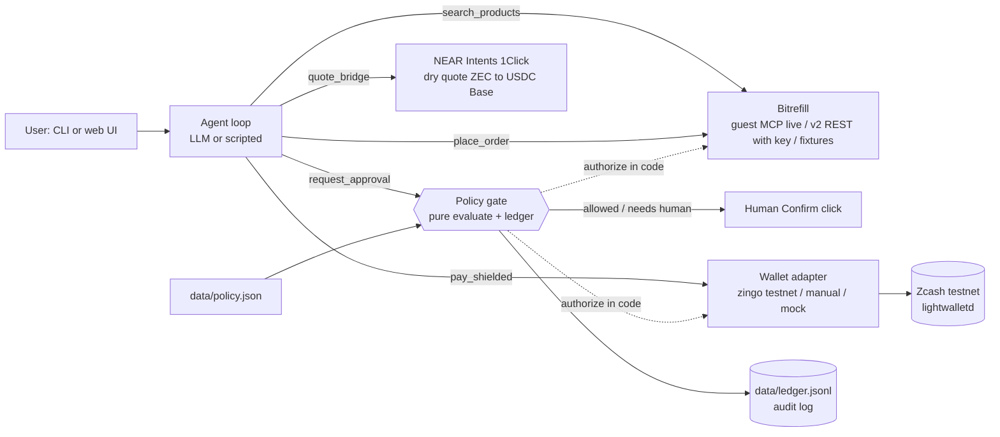

# ZecRecharge

**An AI agent that shops on Bitrefill for Indian goods (Jio recharge, Amazon Pay cards) and pays from a shielded Zcash wallet, under a spending mandate it cannot override.**

- You say "recharge +91… with ₹239 Jio". The agent searches Bitrefill live, a policy gate approves or denies in code, and the agent sends a shielded testnet ZEC transaction whose memo ties the payment to the Bitrefill invoice and to the exact policy in force.
- The model proposes; the gate decides. Daily budget, Bitrefill-only allow-list, category caps and a human-confirm threshold are enforced inside the money-moving tools, not in the prompt.
- Every step in the UI and CLI carries a mode badge (`real`, `test`, `quote`, `fixture`, `mock`, `manual`), so nothing simulated can pass as a payment. See [what is real](#what-is-real-and-what-is-not).

Built at the Zcash Free Society Hackathon, Mumbai, 2026-11-04. Entered in both tracks (Privacy and Agentic). Licence MIT.

Evidence (testnet only):
- Shielded testnet txid: `{{ZEC_TXID}}` ([explorer](https://testnet.zcashexplorer.app/transactions/{{ZEC_TXID}})). Details in `docs/zcash-leg.md`.
- Demo video: `{{VIDEO_URL}}`

## Architecture



Data flow, in order (the gate comes before any invoice or payment):

1. `search_products`: finds the product on Bitrefill (live, through the guest MCP).
2. `request_approval`: the policy gate evaluates and logs the decision. Above `confirmAboveInr` a human must click Confirm. A denial cannot be overridden.
3. `place_order(create)`: creates the Bitrefill invoice (see the table for which mode).
4. `quote_bridge`: a NEAR Intents 1Click **dry** quote for ZEC to USDC on Base. Quote only; nothing is swapped.
5. `pay_shielded`: sends shielded testnet ZEC with memo `ZR1|<invoice_id>|<policy_hash8>`.
6. `place_order(confirm)`: reads the order and shows the delivered code (masked in the UI).

More detail: [docs/ARCHITECTURE.md](docs/ARCHITECTURE.md).

## Run it

Requires [bun](https://bun.sh) 1.4+ (no Node needed).

### Zero keys (scripted, offline, mock wallet)

```bash
bun install
cp .env.example .env
AGENT_MODE=scripted BITREFILL_MODE=offline ZEC_WALLET=mock bun run demo -- "Recharge +919999999999 with ₹239 Jio"
bun test                      # 73 tests, no network or keys needed
bun run serve                 # web UI on http://localhost:3000, click a preset
```

Even with no keys the Bitrefill **search** and the 1Click **quote** are live network calls (guest MCP needs no key). Only the invoice, order and wallet are fixture/mock. Set `BITREFILL_LIVE_SEARCH=0` and `ONECLICK_MODE=offline` for fully offline runs.

Expected: 6/6 steps OK with badges `REAL` (search), `REAL` (gate), `FIXTURE` (invoice), `QUOTE`, `MOCK` (pay, txid starts `mock-`), `FIXTURE` (deliver).

### With keys

```bash
# LLM-driven agent (Claude picks the tool calls; the gate still enforces the policy)
echo 'ANTHROPIC_API_KEY=...' >> .env
AGENT_MODE=llm BITREFILL_MODE=offline ZEC_WALLET=mock bun run demo -- --yes "₹700 Amazon Pay gift card for my mom"

# Bitrefill v2 REST in test mode (free test products, balance + auto_pay)
echo 'BITREFILL_API_KEY=...' >> .env
bun run bitrefill:selftest -- --record      # ping, test order, code, 1Click dry quote
BITREFILL_MODE=test AGENT_MODE=scripted ZEC_WALLET=mock bun run demo -- "Recharge +919999999999 with ₹239 Jio"

# Real shielded testnet send (zingo-cli in Docker, see docs/track-1.md)
docker build -f docker/zingo.Dockerfile -t zecrecharge/zingo-cli .
ZEC_WALLET=zingo bun run wallet:selftest    # self-transfer with memo, waits for a block, decrypts the memo
ZEC_WALLET=zingo BITREFILL_MODE=test AGENT_MODE=scripted bun run demo -- "Recharge +919999999999 with ₹239 Jio"
```

Demo presets (web UI buttons): ₹239 Jio (auto-approved), ₹700 Amazon Pay (Confirm card), ₹1,500 Flipkart (denied: above the ₹1,000 per-purchase cap). Reset the budget before a recording with `bun run demo -- --reset-ledger`.

CLI flags: `--yes` / `--no` (answer the confirm prompt), `--json`, `--reset-ledger`. Env knobs are in `.env.example` and `docs/track-3.md`.

## What is real and what is not

| Part | Mode | What it actually is |
|---|---|---|
| Bitrefill product search | `real` | Live call to the hosted MCP (`api.bitrefill.com/mcp`) with a guest token. No key needed. |
| Policy gate, ledger, policy hash | `real` | Real code. The hash is in every memo. Same code in all modes. |
| Bitrefill invoice and order, no key | `fixture` | Recorded or synthesised responses. The agent shows the real matched product but orders a free test stand-in. Never marked paid. |
| Bitrefill invoice and order, key + `BITREFILL_MODE=test` | `test` | Real v2 API call for a free Bitrefill test product (`test-gift-card-code` / `test-phone-refill`), balance + auto_pay. Needs test products enabled on the account. Not live-verified at time of writing unless the evidence section says so. |
| Bitrefill real product purchase | `real` (guarded) | Only with `BITREFILL_MODE=real` and `BITREFILL_ALLOW_REAL_SPEND=yes`. Crypto invoices are created unpaid. We did not buy a real product. |
| ZEC to USDC (NEAR Intents 1Click) | `quote` | Live **dry** quote. No deposit address, no swap, no funds. 1Click is mainnet-only. |
| Shielded ZEC send, `ZEC_WALLET=zingo` | `test` | A real shielded **testnet** transaction (TAZ) with the memo. By default it is a self-transfer of 0.001 TAZ to our own address, so the memo can be decrypted. It does **not** pay Bitrefill, and the amount is fixed, not the quoted mainnet ZEC. |
| Shielded ZEC send, `ZEC_WALLET=manual` | `manual` | A human sent the transaction from a phone wallet; the txid comes from `WALLET_TXID_OVERRIDE`. |
| Shielded ZEC send, `ZEC_WALLET=mock` | `mock` | In-memory. Txid starts with `mock-`. Nothing on chain. |
| Agent in `AGENT_MODE=llm` | `real` | Claude via the Anthropic API drives the five tools. `scripted` is a regex parser calling the same tools. |

What this means: the Zcash leg and the Bitrefill leg are each independently real or test, but **no mainnet money moves and the testnet send does not settle the Bitrefill invoice.** Connecting them (shielded ZEC to USDC to invoice) is the 30-day milestone below.

## Threat model and privacy note

What the design protects, and what each party can see. Full text for the submission form is in `docs/SUBMISSION.md`.

| Party | What it sees | What it does not see |
|---|---|---|
| **Bitrefill** | The product, the phone number or email for delivery, the invoice and (in a live flow) a USDC-on-Base payment from the swap provider. | The user's Zcash addresses, balance or history; the shielded memo. |
| **The Zcash chain** (anyone) | A shielded transaction: that a transaction happened and its fee/timing. Amount, sender, receiver and memo are encrypted. In a live flow the final hop into the swap deposit address would be visible as a transparent output. | The memo contents, the policy, the invoice id. |
| **lightwalletd / zingo server** (`testnet.zec.rocks`) | The wallet's IP address and which blocks and transactions it fetches. It cannot read note contents. Zingolib does not hide the client IP, so use Tor/VPN if that matters. | Keys, amounts, memos. |
| **LLM provider** (Anthropic, only in `AGENT_MODE=llm`) | The user's request text, product search results and prices, tool results (product names, prices, invoice and order ids, txid, memo). | Wallet keys. Redemption codes go into a separate UI-only field; the tool result returned to the model carries only `has_code: true` (`src/agent/tools.ts`). Scripted mode sends nothing to an LLM. |
| **NEAR Intents 1Click** | The quote request: amounts, the refund and recipient addresses. | Anything about the user, in dry-quote mode. |

Other notes:
- The agent cannot raise its own limits. `data/policy.json` is read by the gate, never by the model, and its hash is committed in each memo.
- Secrets live in `.env` and `.secrets/` (both git-ignored). The Zcash wallet is testnet only (`ZEC_NETWORK` other than `testnet` is refused).
- The ledger (`data/ledger.jsonl`) records product, amount and txid locally. It is not sent anywhere.

## 30-day milestone

Make the swap leg real: shielded ZEC from a mainnet wallet through NEAR Intents 1Click (and Zodl CrossPay where available) into USDC on Base to the Bitrefill invoice address, with the invoice-expiry and under-payment handling we describe in the feedback doc (F21). Then a Telegram front-end so a user can say "recharge my Jio" from a chat, with the same mandate gate. Success means one real mainnet purchase end to end with a published txid chain: shielded txid, swap id, Bitrefill invoice and order.

## Bitrefill feedback

9 things that worked and 22 rough edges (F1 to F22), each with repro, expectation and suggested fix in [docs/bitrefill-feedback.md](docs/bitrefill-feedback.md). Note that the v2 REST items came from the docs, not live calls, unless marked otherwise.

## Docs

- [docs/ARCHITECTURE.md](docs/ARCHITECTURE.md): components, gate design, modes
- [docs/SUBMISSION.md](docs/SUBMISSION.md): form text
- [docs/VIDEO_SCRIPT.md](docs/VIDEO_SCRIPT.md): shot list and narration
- `docs/track-1.md` wallet, `docs/track-2.md` Bitrefill and bridge, `docs/track-3.md` policy, agent, UI

## Team

ZecRecharge contributors. MIT licence, see [LICENSE](LICENSE).
