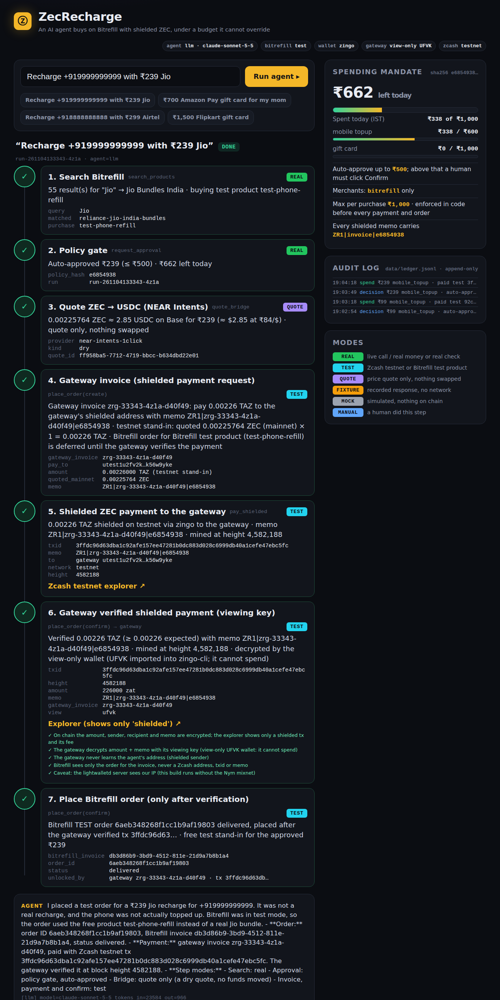
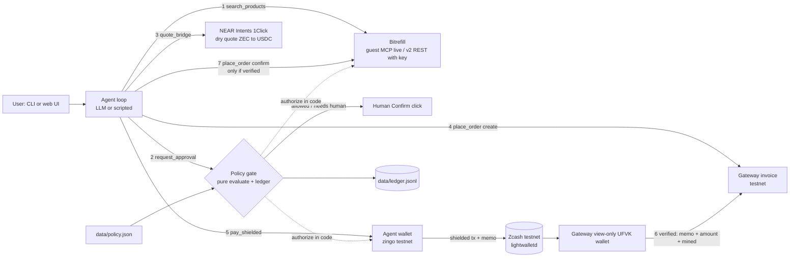

# ZecRecharge

**An AI agent pays shielded ZEC to a viewing-key gateway; only a verified payment unlocks the Bitrefill order for Indian goods (Jio recharge, Amazon Pay cards). Testnet + Bitrefill test products, under a spending mandate it cannot override. Bitrefill never receives ZEC.**

- You say "recharge +91… with ₹239 Jio". The agent searches Bitrefill live, a policy gate approves or denies in code, and the agent sends a shielded testnet ZEC transaction to a separate gateway wallet. The memo `ZR1|<invoice>|<hash8>` ties the payment to the invoice and to the exact policy in force.
- The gateway holds only a **view-only (UFVK) wallet**. It matches memo, amount and mined status. **Only a verified payment triggers the Bitrefill order.** If verification times out, no order is placed.
- The model proposes; the gate decides. Daily budget, Bitrefill-only allow-list, category caps and a human-confirm threshold are enforced inside the money-moving tools, not in the prompt.
- Every step carries a mode badge (`real`, `test`, `quote`, `fixture`, `mock`, `manual`), so nothing simulated passes as a payment. See [what is real](#what-is-real-and-what-is-labelled).

Built at the Zcash Free Society Hackathon, Mumbai, 2026-11-04. Entered in both tracks (Privacy and Agentic). Licence MIT.

**Testnet only.** No mainnet payment was made and no real product was bought. The Bitrefill order is a free Bitrefill test product, placed after a real shielded testnet payment was verified.

Evidence: see [Evidence](#evidence) below. Demo video: `{{VIDEO_URL}}`



## Run it

Requires [bun](https://bun.sh) 1.4+ (no Node needed).

### Zero keys (scripted, offline, mock wallet)

```bash
bun install
cp .env.example .env
AGENT_MODE=scripted BITREFILL_MODE=offline ZEC_WALLET=mock bun run demo -- "Recharge +919999999999 with ₹239 Jio"
bun test                      # 123 tests, no network or keys needed
bun run serve                 # web UI on http://localhost:3000, click a preset
```

The web server binds `127.0.0.1` by default (`PORT` defaults to 3000). It has no login, so anyone who can reach it can start a run and press Confirm: `HOST=0.0.0.0` opts in to exposing it on your network, and only do that on a network you trust. POST endpoints (`/api/run`, `/api/confirm/:id`) accept only `application/json` from the same origin; cross-origin POSTs and non-loopback `Host` headers (DNS rebinding) get HTTP 403.

Even with no keys the Bitrefill **search** and the 1Click **quote** are live network calls (guest MCP needs no key). Only the gateway, invoice, order and wallet are mock/fixture. Set `BITREFILL_LIVE_SEARCH=0` and `ONECLICK_MODE=offline` for fully offline runs.

A blank request (`bun run demo -- ""`) is a usage error (exit 2); with no request at all the demo runs the ₹239 Jio example. Requests outside India (£, $, €, a non-+91 number) are refused as "India only (INR)". `AGENT_MODE=llm` without `ANTHROPIC_API_KEY` stops with a hint to use `AGENT_MODE=scripted`.

Expected: 7/7 steps OK with badges `REAL` (search), `REAL` (gate), `QUOTE`, `MOCK` (gateway invoice, pay with a `mock-` txid, gateway verification) and `FIXTURE` (order).

### With keys (the real flow)

```bash
# keys come from .env (bun loads it): ANTHROPIC_API_KEY, BITREFILL_API_KEY
export AGENT_MODE=llm ZEC_WALLET=zingo BITREFILL_MODE=test   # gateway defaults to the view-only UFVK wallet
docker build -f docker/zingo.Dockerfile -t zecrecharge/zingo-cli .   # zingo-cli, see docs/track-1.md
bun run demo -- --reset-ledger                               # fresh ₹1,000 budget
bun run serve                                                # click the presets; 7/7 takes about 1.5-2.5 minutes
bun run demo -- "Recharge +919999999999 with ₹239 Jio"       # same from the CLI
bun run demo -- --yes "₹700 Amazon Pay gift card for my mom"
```

Smaller steps: `AGENT_MODE=llm BITREFILL_MODE=offline ZEC_WALLET=mock bun run demo -- --yes "…"` (LLM only), `BITREFILL_MODE=test bun run bitrefill:selftest` (v2 ping and a free test order), `ZEC_WALLET=zingo bun run wallet:selftest`.

Demo presets: ₹239 Jio (auto-approved), ₹700 Amazon Pay (Confirm card), ₹1,500 Flipkart (denied: above the ₹1,000 per-purchase cap). CLI flags: `--yes` / `--no`, `--json`, `--reset-ledger`. A denied or human-rejected run prints why, says nothing was paid or ordered, and exits 0 (an expected outcome); only a failed run exits 1. Do not start a CLI payment while a web run is paying; a wallet lock (`.secrets/zingo-testnet/.zr-session.lock`, holding the owner's PID) makes the second one wait. Ctrl-C or SIGTERM releases it, and a lock left by a dead process is taken over at once. With `ZEC_WALLET=zingo`, a 5-second preflight checks Docker and the `zecrecharge/zingo-cli` image and exits with the build command if either is missing.

### Gateway settings and scripts

| Setting | Default | Meaning |
|---|---|---|
| `GATEWAY_MODE` | empty: `ufvk` with `ZEC_WALLET=zingo`, else `mock` | `ufvk` = view-only wallet from the gateway UFVK; `wallet` = the gateway's full wallet; `mock` = in-memory |
| `GATEWAY_TIMEOUT_MS` | `720000` | No verified payment in this time means no Bitrefill order |
| `GATEWAY_POLL_MS` | `10000` | How often the gateway polls its wallet |
| `GATEWAY_TESTNET_SCALE` | `1` | TAZ sent = quoted mainnet ZEC × scale, rounded to 1,000 zat, clamped to 0.001–0.01 TAZ |

| Script | What it does |
|---|---|
| `bun run gateway:selftest` | `ZEC_WALLET=zingo`: agent pays the gateway 0.001 TAZ, the UFVK wallet must verify it (about 1.5 min) |
| `bun run wallet:split -- 6 5000000` | One tx that splits funds into 6 notes of 0.05 TAZ to self, so back-to-back runs do not wait for change (wait about 5 minutes, 3+ blocks, before the next run) |
| `bun run wallet:selftest` | Wallet check only, not the purchase flow: a shielded self-transfer with memo, waits for a block, decrypts the memo |
| `bun run bitrefill:selftest` | v2 ping, free test order, 1Click dry quote |

## Architecture



The flow, in order (the gate comes before any invoice or payment):

| # | Step | Tool | Mode in a real run |
|---|---|---|---|
| 1 | Search Bitrefill | `search_products` | `real` |
| 2 | Policy gate | `request_approval` | `real`, or `manual` when a human confirms |
| 3 | Quote ZEC to USDC (NEAR Intents) | `quote_bridge` | `quote` (dry quote; nothing swapped) |
| 4 | Gateway invoice | `place_order(create)` | `test` |
| 5 | Shielded ZEC payment to the gateway, memo `ZR1\|<invoice>\|<hash8>` | `pay_shielded` | `test` (real testnet tx) |
| 6 | Gateway verified shielded payment (viewing key) | inside `place_order(confirm)` | `test` |
| 7 | Place the Bitrefill order, only after step 6 | `place_order(confirm)` | `test` (free test product) |

The quote comes before the invoice because the gateway prices its invoice from it. Verification runs in code inside `place_order(confirm)`, so the LLM cannot skip it. More detail: [docs/ARCHITECTURE.md](docs/ARCHITECTURE.md).

## What is real and what is labelled

| Piece | Real? | Label in the UI and CLI |
|---|---|---|
| Bitrefill product search | real, live v2/MCP | `real` |
| Policy gate, ledger, policy hash in the memo | real code | `real` / `manual` (human click) |
| NEAR Intents 1Click quote | live **dry** quote, nothing swapped; falls back to a fixture if 1Click errors (for example on tiny amounts) | `quote` / `fixture` |
| Gateway invoice | real gateway logic, testnet | `test` |
| Shielded payment | **real testnet tx**: TAZ, not ZEC; the amount is a testnet stand-in for the quoted mainnet ZEC | `test` |
| Gateway verification | **real**: a view-only UFVK wallet decrypts memo and amount on testnet | `test` |
| Bitrefill order | **real Bitrefill API order of a free TEST product** (`test-phone-refill`, `test-gift-card-code`); the matched real Indian product (for example `reliance-jio-india-bundles`) is shown but not bought | `test` |
| ZEC → USDC settlement to Bitrefill | **not done**: quote only (mainnet, no funds) | `quote` |

Read this plainly: the gateway is our own testnet merchant stand-in. Bitrefill is not paid in ZEC, and no real product was bought. What is real is the chain from a mandate-checked shielded payment, to viewing-key verification, to the order call. The testnet amount is the quoted mainnet ZEC clamped to 0.001–0.01 TAZ and is labelled "testnet stand-in" in the UI. With no keys, the gateway is `mock` and the order a `fixture`. Bitrefill search for "Amazon" with a key returns only Amazon Fresh, so the Amazon Pay preset shows `amazon-fresh-india` as the match. 1Click rejects tiny amounts, so the quote then falls back to a labelled fixture.

## Evidence

Real runs on Zcash **testnet**, 2026-11-04. Agent wallet to gateway wallet, each verified by the gateway's view-only wallet. Explorer pages show only a shielded tx and its fee. (Plain `curl` gets HTTP 403 from the explorer; use a browser.)

- Web UI run with human Confirm, ₹700 Amazon Pay: `0863ac3207142f08e974f28e03bd0f67f2587c12607db4267d628d40505fa93f` ([explorer](https://testnet.zcashexplorer.app/transactions/0863ac3207142f08e974f28e03bd0f67f2587c12607db4267d628d40505fa93f)). Block 4,582,167, shielded, fee 0.0001 TAZ, 0.00658 TAZ. Verified on the explorer. Order is a test gift card.
- CLI run, ₹239 Jio: `e2959ddaea078e7a40a6f1bde2304f1635c611cd699adee8f849dbc368a751ce` ([explorer](https://testnet.zcashexplorer.app/transactions/e2959ddaea078e7a40a6f1bde2304f1635c611cd699adee8f849dbc368a751ce)), block 4,582,164.
- Web UI run, ₹239 Jio (the screenshot above): `3ffdc96d63dba1c92afe157ee47281b0dc883d028c6999db40a1cefe47ebc5fc` ([explorer](https://testnet.zcashexplorer.app/transactions/3ffdc96d63dba1c92afe157ee47281b0dc883d028c6999db40a1cefe47ebc5fc)), block 4,582,188, 0.00226 TAZ.
- Gateway selftest: `d07f81fc9fd922deeead4f10bb5a015574fa411d1b852e9958300074c1148a18` ([explorer](https://testnet.zcashexplorer.app/transactions/d07f81fc9fd922deeead4f10bb5a015574fa411d1b852e9958300074c1148a18)), 0.001 TAZ, verified at block 4,582,172 in 85 s.
- **Negative test**, verification timeout forced to 8 s: `92cdb323eb15211576b4d2db6d6a31cd38ced754d2ae88bbf5a4bc1950eb32e0` ([explorer](https://testnet.zcashexplorer.app/transactions/92cdb323eb15211576b4d2db6d6a31cd38ced754d2ae88bbf5a4bc1950eb32e0)). Paid and seen in the mempool, but the gateway did not verify in time, so **no Bitrefill order was placed**.

The full table of runs with gateway invoices, memos, heights and Bitrefill test order ids are in [docs/integration.md](docs/integration.md). A live denial was also checked: ₹99 with ₹61 left gave "DENIED … would exceed the daily budget" and nothing was sent.

## Threat model and privacy note

What the design protects, and what each party can see. Details in `docs/ARCHITECTURE.md`; submission text in `docs/SUBMISSION.md`.

| Party | What it sees | What it does not see |
|---|---|---|
| **The Zcash chain** (anyone) | A shielded transaction exists, with its timing and fee. | Amount, sender, recipient and memo (all encrypted). |
| **The gateway** (view-only UFVK wallet) | Incoming payments to its address: amount, memo, block. It matches memo `ZR1\|<invoice>\|<hash8>`. | The agent's address, balance or history. It cannot spend. |
| **Bitrefill** | The product, the delivery phone or email, and the order. | Any Zcash address, the payment, the memo. |
| **lightwalletd** (`testnet.zec.rocks`) | The wallet's IP address and which blocks and transactions it fetches. This build has no mixnet or Tor. | Keys, amounts, memos. |
| **LLM provider** (Anthropic, only in `AGENT_MODE=llm`) | The request text, search results and prices, tool results (invoice and order ids, txid, memo). | Wallet keys. Redemption codes go to a UI-only field; the model sees only `has_code: true`. Scripted mode sends nothing to an LLM. |
| **NEAR Intents 1Click** | The dry-quote request (amounts, addresses). | Anything about the user; no deposit address is issued. |

Other notes:
- The agent cannot raise its own limits. `data/policy.json` is read by the gate, never by the model, and its hash is committed in each memo.
- Secrets live in `.env` and `.secrets/` (both git-ignored). The Zcash wallet is testnet only (`ZEC_NETWORK` other than `testnet` is refused).
- The ledger (`data/ledger.jsonl`) records product, amount and txid locally. It is not sent anywhere.

## 30-day milestone

Make the settlement leg real: shielded ZEC from a mainnet wallet through NEAR Intents 1Click (and Zodl CrossPay where available) into USDC on Base to the Bitrefill invoice address, with the invoice-expiry and under-payment handling we describe in the feedback doc (F21). Then a Telegram front-end so a user can say "recharge my Jio" from a chat, with the same mandate gate. Success means one real mainnet purchase end to end with a published txid chain: shielded txid, swap id, Bitrefill invoice and order.

## Bitrefill feedback

9 things that worked and 22 rough edges (F1 to F22), each with repro, expectation and suggested fix in [docs/bitrefill-feedback.md](docs/bitrefill-feedback.md). Items marked *verified live* were hit with a real API key on 2026-11-04; the others came from the docs.

## Docs

- [docs/ARCHITECTURE.md](docs/ARCHITECTURE.md): components, gate design, modes
- [docs/SUBMISSION.md](docs/SUBMISSION.md): form text
- [docs/VIDEO_SCRIPT.md](docs/VIDEO_SCRIPT.md): caption-based shot list
- [docs/integration.md](docs/integration.md): the real flow, all txids, pre-recording checklist
- `docs/track-1.md` wallet, `docs/track-2.md` Bitrefill and bridge, `docs/track-3.md` policy, agent, UI

## Team

ZecRecharge contributors. MIT licence, see [LICENSE](LICENSE).
